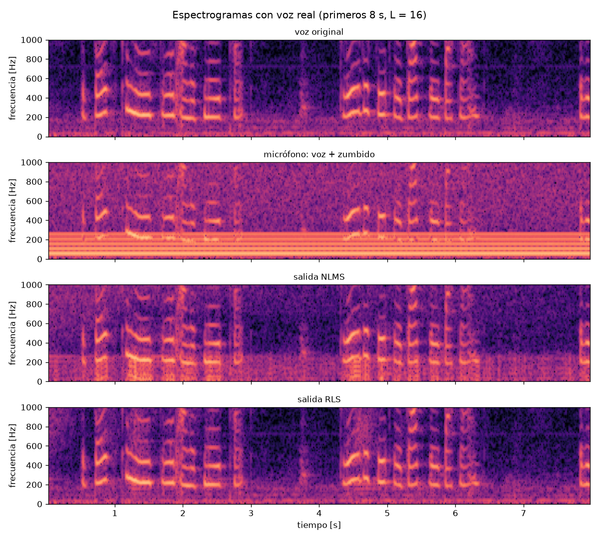
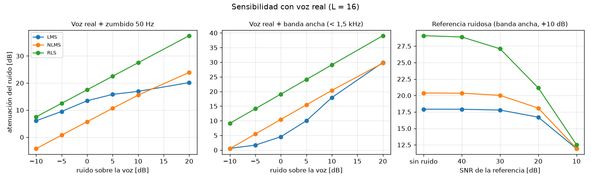

# Cancelación adaptativa de ruido con filtros LMS, NLMS y RLS

Proyecto del curso **ACUS220 — Acústica Computacional con Python**, Universidad Austral de Chile.
Integrante: Ninoska Toledo.

## Idea del proyecto
Implementar desde cero, con NumPy, filtros adaptativos (LMS, NLMS y RLS) que cancelan
un ruido (zumbido de 50 Hz, ventilador, motor) usando una señal de referencia del ruido,
y comparar su desempeño.

## Pregunta principal
¿Qué algoritmo adaptativo (LMS, NLMS o RLS) logra la mejor cancelación de ruido
según el tipo de ruido y la longitud del filtro?

Preguntas secundarias que surgieron en el Hito 1:
- ¿Cuánto degrada la propia voz la adaptación de LMS/NLMS (desajuste)?
- ¿Qué compromiso hay entre velocidad de convergencia y ruido residual al elegir μ?

Pregunta secundaria del Hito 2:
- ¿Cuánto se pierde si la referencia del ruido también está contaminada (caso real con dos micrófonos)?

## Motivación
Muchos sistemas reales necesitan separar una señal útil de un ruido conocido:
zumbido de red eléctrica en grabaciones, ruido de motor en cabinas, ventiladores en
salas. Los filtros adaptativos aprenden la ruta acústica del ruido sin conocerla de antemano.
Implementarlos desde cero permite ver cómo aprende el filtro y medir cuánto ruido se elimina en dB.

> **Alcance.** Lo implementado es *cancelación adaptativa de ruido* (esquema de Widrow):
> el ruido estimado se resta digitalmente de la señal del micrófono. El *control activo*
> de ruido de los audífonos (ANC) agrega un parlante y una ruta secundaria, y requiere
> FxLMS; se deja como extensión (ver próximos pasos).

## Datos
| Aspecto | Hito 1 (actual) |
|---|---|
| Tipo | Señales sintéticas generadas en `src/signals.py` (reproducibles con semilla fija) |
| Frecuencia de muestreo | 8 000 Hz |
| Duración | 4 s por señal (3 s en las pruebas) |
| Señal útil `s` | "Voz" sintética: f0 ≈ 140 Hz ± 20 Hz, 5 armónicos, envolvente de 3 Hz |
| Ruido tonal | 50 Hz + 4 armónicos (amplitud 1/k) + ruido blanco leve |
| Ruido de banda ancha | Ruido blanco filtrado por Butterworth de orden 4, corte 1,5 kHz |
| Ruta acústica `h` | FIR de 16 coeficientes aleatorios con decaimiento exponencial |
| Relación ruido/voz | ~10 dB (el ruido domina la señal del micrófono) |

**Limitaciones conocidas:** la voz sintética es mucho más regular que una voz real,
la ruta acústica es fija (no cambia en el tiempo) y la referencia es casi perfecta.

### Voz real (Hito 2)
| Aspecto | Valor |
|---|---|
| Fuente | Open Speech Repository (Telchemy), frases Harvard en inglés americano |
| Archivos | `OSR_us_000_0010_8k.wav` (33,6 s), `OSR_us_000_0030_8k.wav` (46,9 s) |
| Formato | WAV PCM 16 bits, mono, 8 000 Hz |
| Nivel | RMS ≈ −27 dBFS, pico 0,33 y 0,54 |
| Piso de ruido | `0010`: rango dinámico 32 dB; `0030`: 48 dB |
| Energía de la voz | ~60 % entre 80 y 260 Hz (misma banda que los armónicos del zumbido) |
| Licencia | Uso libre citando "Open Speech Repository" |

Los audios no se versionan: `src/datos.py` los descarga en `data/raw/` la primera vez.
La exploración completa está en `notebooks/exploracion_voz_real.ipynb`.

**Pendiente (Hito 3):** grabaciones propias con dos micrófonos (referencia + error).

## Pipeline
```
señal útil s[n] ──────────────────────────┐
                                          ▼
ruido x[n] ──► ruta acústica h ──► ruido en mic ──► (+) ──► d[n]  (micrófono)
   │                                                          │
   └──────────► filtro adaptativo w ──► y[n] ──────► (−) ◄────┘
                      ▲                              │
                      └───────── e[n] (salida) ◄─────┘
                                     │
                                     ▼
          métricas: atenuación [dB], convergencia [s], cómputo [s], espectro
```

## Método
```
d[n] = s[n] + (h * x)[n]     señal deseada + ruido filtrado por la ruta acústica
y[n] = w^T x[n]              estimación del ruido
e[n] = d[n] - y[n]           señal limpia (salida)
w   <- w + mu * e[n] * x[n]  actualización LMS (NLMS normaliza por ||x||^2; RLS usa la
                             matriz de correlación inversa con factor de olvido lambda)
```
Métricas (`src/adaptive.py`, `src/metricas.py`), medidas desde t = 1 s:
- **Atenuación [dB]:** potencia del ruido antes / potencia del residuo `e − s` después.
- **Tiempo de convergencia [s]:** primer instante en que la atenuación instantánea
  (media móvil causal de 10 ms) llega a 3 dB de su valor final.
- **Costo computacional:** tiempo de ejecución de cada algoritmo.

## Resultados del Hito 1

### Zumbido de 50 Hz, L = 32 (`src/demo_hito1.py`)
| Algoritmo | Parámetro | Atenuación | Convergencia | Cómputo |
|---|---|---|---|---|
| LMS | μ = 0,005 | 12,9 dB | 18 ms | 0,05 s |
| NLMS | μ = 0,05 | 12,5 dB | 19 ms | 0,08 s |
| RLS | λ = 0,999 | **26,8 dB** | 65 ms | 0,26 s |


Los audios de antes y después están en `results/audio/`.

### Barrido de longitud del filtro y tipo de ruido (`src/experimento_barrido.py`)


### Interpretación del Hito 1
1. **RLS es el mejor en todas las combinaciones probadas:** con L ≥ 8 logra 24–29 dB,
   frente a 11–25 dB de LMS/NLMS, a cambio de ~4–9 veces más cómputo
   (costo O(L²) por muestra vs O(L)).
2. **Con ruido de banda ancha, L debe cubrir la ruta acústica:** con L = 4 la atenuación
   cae a ~10 dB para todos los algoritmos; desde L ≈ 8–16 se estabiliza. Con el zumbido,
   en cambio, bastan pocos coeficientes porque son solo 5 sinusoides.
3. **L demasiado grande también empeora:** más coeficientes significan más desajuste
   (el filtro "persigue" más ruido de gradiente).
4. **La voz perturba a LMS/NLMS:** el residuo sube en la banda de la voz (120–160 Hz) y
   oscila con su envolvente, porque `e[n]` contiene la voz y actúa como ruido en la
   actualización. Probablemente por esto LMS/NLMS rinden menos con el zumbido (cuyos
   armónicos caen cerca de la voz) que con banda ancha; falta verificarlo variando la SNR.
5. **Compromiso de μ en NLMS:** pasar de μ = 0,005 a 0,5 reduce la convergencia de
   ~280 ms a ~1 ms, pero la atenuación baja de ~15 dB a ~9,5 dB.

## Resultados del Hito 2 (`src/demo_hito2.py`)

### Voz real + zumbido, ruido 10 dB sobre la voz, L = 16
| Algoritmo | Atenuación | Convergencia |
|---|---|---|
| LMS (μ = 0,005) | 17,8 dB | 0,57 s |
| NLMS (μ = 0,05) | 16,3 dB | 1,03 s |
| RLS (λ = 0,999) | **29,1 dB** | 0,50 s |




Audios en `results/audio/hito2_*.wav`; tablas en `results/hito2_*.csv`.

### Interpretación del Hito 2
1. **Se confirma la hipótesis del Hito 1: la voz limita la cancelación.** Al bajar el
   ruido respecto de la voz (de +20 a −10 dB), la atenuación cae en todos los algoritmos.
   En RLS con zumbido la atenuación baja exactamente 5 dB por cada 5 dB (37,5 → 7,5 dB):
   el residuo tiene una potencia fija, determinada por la voz y no por el ruido.
2. **NLMS puede empeorar la señal:** con el ruido 10 dB *bajo* la voz, NLMS da −4,3 dB
   (agrega ruido). Al normalizar por la potencia de la referencia, su paso efectivo no
   se reduce cuando el ruido es débil, y la voz domina la actualización. LMS con μ fijo
   se vuelve más lento en ese caso y por eso sufre menos.
3. **El espectrograma lo muestra:** con NLMS queda energía bajo ~280 Hz que sigue el
   ritmo de la voz; con RLS el resultado es casi igual a la voz original.
4. **La calidad de la referencia pone un techo:** con SNR de referencia de 10 dB los
   tres algoritmos quedan en ~12 dB, aunque sin ruido en la referencia RLS llega a 29 dB.
   Para el Hito 3 esto exige un micrófono de referencia lo más cerca posible de la fuente.
5. **El tiempo de convergencia con voz real es menos confiable:** la voz empieza
   alrededor de 0,6 s y altera la atenuación instantánea al inicio.

## Dificultades y preguntas abiertas
- Definir una métrica de convergencia robusta: la primera versión (media móvil centrada)
  daba 0 s por el relleno con ceros al inicio; se reemplazó por la atenuación instantánea causal.
- Cómo medir la atenuación con datos reales, donde no se conoce la voz limpia `s`.
- La "voz limpia" del dataset tiene su propio piso de ruido (`0010`), que el filtro no
  puede cancelar porque no está en la referencia.
- Cómo elegir μ automáticamente: el mejor valor depende de la relación ruido/voz.
- Sincronizar dos micrófonos independientes (dos celulares tienen relojes distintos:
  desfase y deriva de la frecuencia de muestreo).
- La implementación muestra a muestra en Python es lenta para señales largas y RLS con L grande.

## Plan
| Hito | Objetivo | Estado |
|------|----------|--------|
| 1 | LMS, NLMS y RLS sobre señales sintéticas; métricas y barrido de L y μ. | ✅ |
| 2 | Voz real de un dataset público; sensibilidad a la relación ruido/voz y al ruido en la referencia; notebook de exploración. | ✅ |
| 2+ | Ruidos reales grabados (ventilador) y ruta acústica variable en el tiempo. | Pendiente |
| 3 | Grabaciones reales con dos micrófonos sincronizados y demo con audio; FxLMS simulado como extensión. | Pendiente |

**Próxima acción concreta:** grabar un ruido real de ventilador y simular una ruta
acústica que cambia en el tiempo, para ver qué algoritmo sigue mejor los cambios.

## Uso
```bash
python -m venv .venv && source .venv/bin/activate
pip install -r requirements.txt
python src/demo_hito1.py           # figuras hito1_*.png, results/hito1_metricas.csv y audios
python src/experimento_barrido.py  # figuras barrido_*.png y results/barrido_*.csv
python src/demo_hito2.py           # descarga la voz real; figuras y resultados hito2_*
pytest                             # pruebas
```

## Estructura
```
src/        algoritmos (adaptive.py), métricas (metricas.py), señales (signals.py),
            carga de voz real (datos.py), demos de los hitos 1 y 2 y experimento de barrido
tests/      pruebas de los algoritmos y métricas
notebooks/  exploración de la voz real
data/raw/   grabaciones reales (no versionadas)
figures/    gráficos generados
results/    tablas CSV y audios generados
references/ bibliografía
```

## Referencias
- Widrow, B., et al. (1975). Adaptive noise cancelling: Principles and applications.
  *Proceedings of the IEEE*, 63(12), 1692–1716.
- Haykin, S. (2014). *Adaptive Filter Theory* (5.ª ed.). Pearson.
- Kuo, S. M., & Morgan, D. R. (1996). *Active Noise Control Systems: Algorithms and DSP
  Implementations*. Wiley.
- Telchemy. *Open Speech Repository*. https://www.voiptroubleshooter.com/open_speech/
- Harris, C. R., et al. (2020). Array programming with NumPy. *Nature*, 585, 357–362.
- Virtanen, P., et al. (2020). SciPy 1.0: Fundamental algorithms for scientific computing
  in Python. *Nature Methods*, 17, 261–272.
- Hunter, J. D. (2007). Matplotlib: A 2D graphics environment. *Computing in Science &
  Engineering*, 9(3), 90–95.

## Declaración de uso de inteligencia artificial
Se utilizó Claude Code (Anthropic) como apoyo para revisar el repositorio contra la pauta
del Hito 1, proponer y escribir los scripts de visualización, del experimento de barrido
y de los experimentos con voz real del Hito 2, armar el notebook de exploración, corregir
la métrica de tiempo de convergencia y redactar parte de esta documentación.
La formulación del problema, la elección de los algoritmos y la interpretación de los
resultados fueron revisadas por la integrante del proyecto.
