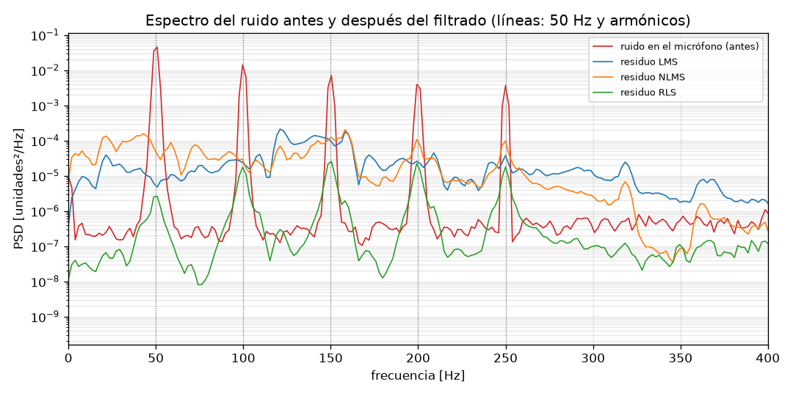
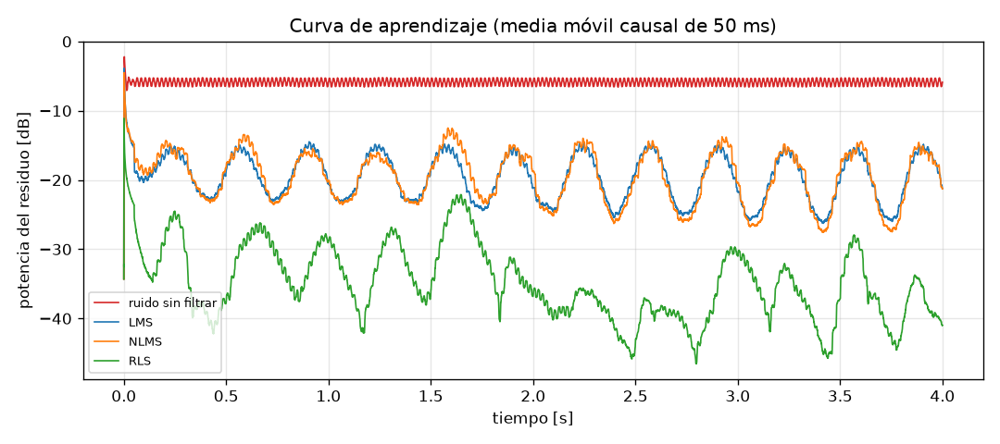
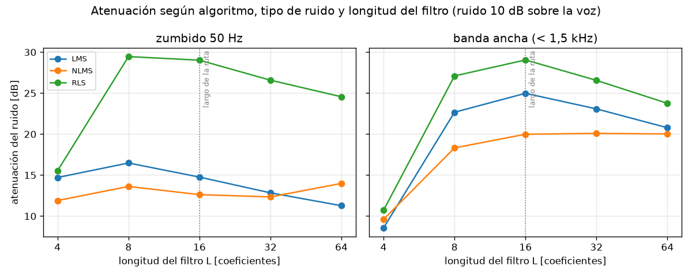
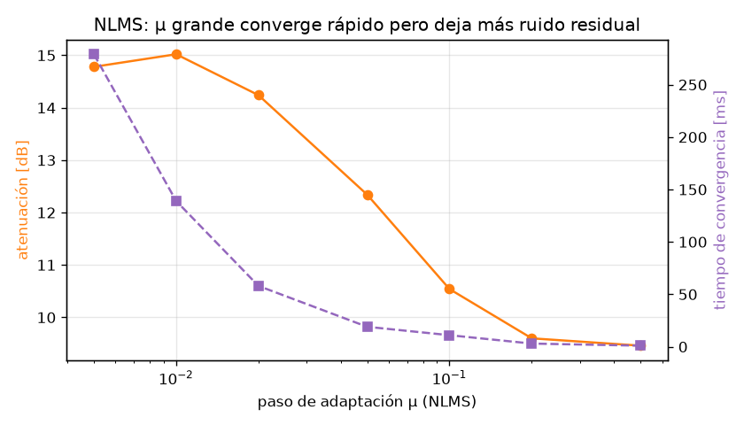

# Cancelación adaptativa de ruido con filtros LMS, NLMS y RLS

Proyecto del curso **ACUS220 — Acústica Computacional con Python**, Universidad Austral de Chile.
Integrante: Ninoska Toledo.

## Idea del proyecto
Implementar desde cero, con NumPy, filtros adaptativos (LMS, NLMS y RLS) que cancelan
un ruido (zumbido de 50 Hz, ventilador, motor) usando una señal de referencia del ruido,
y comparar su desempeño.

## Pregunta principal
¿Qué algoritmo adaptativo (LMS, NLMS o RLS) logra la mejor cancelación de ruido
según el tipo de ruido y la longitud del filtro?

Preguntas secundarias que surgieron en el Hito 1:
- ¿Cuánto degrada la propia voz la adaptación de LMS/NLMS (desajuste)?
- ¿Qué compromiso hay entre velocidad de convergencia y ruido residual al elegir μ?

## Motivación
Muchos sistemas reales necesitan separar una señal útil de un ruido conocido:
zumbido de red eléctrica en grabaciones, ruido de motor en cabinas, ventiladores en
salas. Los filtros adaptativos aprenden la ruta acústica del ruido sin conocerla de antemano.
Implementarlos desde cero permite ver cómo aprende el filtro y medir cuánto ruido se elimina en dB.

> **Alcance.** Lo implementado es *cancelación adaptativa de ruido* (esquema de Widrow):
> el ruido estimado se resta digitalmente de la señal del micrófono. El *control activo*
> de ruido de los audífonos (ANC) agrega un parlante y una ruta secundaria, y requiere
> FxLMS; se deja como extensión (ver próximos pasos).

## Datos
| Aspecto | Hito 1 (actual) |
|---|---|
| Tipo | Señales sintéticas generadas en `src/signals.py` (reproducibles con semilla fija) |
| Frecuencia de muestreo | 8 000 Hz |
| Duración | 4 s por señal (3 s en las pruebas) |
| Señal útil `s` | "Voz" sintética: f0 ≈ 140 Hz ± 20 Hz, 5 armónicos, envolvente de 3 Hz |
| Ruido tonal | 50 Hz + 4 armónicos (amplitud 1/k) + ruido blanco leve |
| Ruido de banda ancha | Ruido blanco filtrado por Butterworth de orden 4, corte 1,5 kHz |
| Ruta acústica `h` | FIR de 16 coeficientes aleatorios con decaimiento exponencial |
| Relación ruido/voz | ~10 dB (el ruido domina la señal del micrófono) |

**Limitaciones conocidas:** la voz sintética es mucho más regular que una voz real,
la ruta acústica es fija (no cambia en el tiempo) y la referencia es casi perfecta.

**Datos reales (Hitos 2–3):** voz real de un dataset público y grabaciones con dos
micrófonos (referencia + error). Se guardan en `data/raw/` y no se versionan.

## Pipeline
```
señal útil s[n] ──────────────────────────┐
                                          ▼
ruido x[n] ──► ruta acústica h ──► ruido en mic ──► (+) ──► d[n]  (micrófono)
   │                                                          │
   └──────────► filtro adaptativo w ──► y[n] ──────► (−) ◄────┘
                      ▲                              │
                      └───────── e[n] (salida) ◄─────┘
                                     │
                                     ▼
          métricas: atenuación [dB], convergencia [s], cómputo [s], espectro
```

## Método
```
d[n] = s[n] + (h * x)[n]     señal deseada + ruido filtrado por la ruta acústica
y[n] = w^T x[n]              estimación del ruido
e[n] = d[n] - y[n]           señal limpia (salida)
w   <- w + mu * e[n] * x[n]  actualización LMS (NLMS normaliza por ||x||^2; RLS usa la
                             matriz de correlación inversa con factor de olvido lambda)
```
Métricas (`src/adaptive.py`, `src/metricas.py`), medidas desde t = 1 s:
- **Atenuación [dB]:** potencia del ruido antes / potencia del residuo `e − s` después.
- **Tiempo de convergencia [s]:** primer instante en que la atenuación instantánea
  (media móvil causal de 10 ms) llega a 3 dB de su valor final.
- **Costo computacional:** tiempo de ejecución de cada algoritmo.

## Resultados del Hito 1

### Zumbido de 50 Hz, L = 32 (`src/demo_hito1.py`)
| Algoritmo | Parámetro | Atenuación | Convergencia | Cómputo |
|---|---|---|---|---|
| LMS | μ = 0,005 | 12,9 dB | 18 ms | 0,05 s |
| NLMS | μ = 0,05 | 12,5 dB | 19 ms | 0,08 s |
| RLS | λ = 0,999 | **26,8 dB** | 65 ms | 0,26 s |




Los audios de antes y después están en `results/audio/`.

### Barrido de longitud del filtro y tipo de ruido (`src/experimento_barrido.py`)



### Interpretación
1. **RLS es el mejor en todas las combinaciones probadas:** con L ≥ 8 logra 24–29 dB,
   frente a 11–25 dB de LMS/NLMS, a cambio de ~4–9 veces más cómputo
   (costo O(L²) por muestra vs O(L)).
2. **Con ruido de banda ancha, L debe cubrir la ruta acústica:** con L = 4 la atenuación
   cae a ~10 dB para todos los algoritmos; desde L ≈ 8–16 se estabiliza. Con el zumbido,
   en cambio, bastan pocos coeficientes porque son solo 5 sinusoides.
3. **L demasiado grande también empeora:** más coeficientes significan más desajuste
   (el filtro "persigue" más ruido de gradiente).
4. **La voz perturba a LMS/NLMS:** el residuo sube en la banda de la voz (120–160 Hz) y
   oscila con su envolvente, porque `e[n]` contiene la voz y actúa como ruido en la
   actualización. Probablemente por esto LMS/NLMS rinden menos con el zumbido (cuyos
   armónicos caen cerca de la voz) que con banda ancha; falta verificarlo variando la SNR.
5. **Compromiso de μ en NLMS:** pasar de μ = 0,005 a 0,5 reduce la convergencia de
   ~280 ms a ~1 ms, pero la atenuación baja de ~15 dB a ~9,5 dB.

## Dificultades y preguntas abiertas
- Definir una métrica de convergencia robusta: la primera versión (media móvil centrada)
  daba 0 s por el relleno con ceros al inicio; se reemplazó por la atenuación instantánea causal.
- Cómo medir la atenuación con datos reales, donde no se conoce la voz limpia `s`.
- Sincronizar dos micrófonos independientes (dos celulares tienen relojes distintos:
  desfase y deriva de la frecuencia de muestreo).
- La implementación muestra a muestra en Python es lenta para señales largas y RLS con L grande.

## Plan
| Hito | Objetivo | Estado |
|------|----------|--------|
| 1 | LMS, NLMS y RLS sobre señales sintéticas; métricas y barrido de L y μ. | ✅ |
| 2 | Voz real de un dataset público + ruidos grabados; sensibilidad a SNR, ruido en la referencia y ruta variable en el tiempo; notebook de exploración. | En curso |
| 3 | Grabaciones reales con dos micrófonos sincronizados y demo con audio; FxLMS simulado como extensión. | Pendiente |

**Próxima acción concreta:** escoger el dataset de voz real y repetir `demo_hito1.py`
con voz real en lugar de la voz sintética.

## Uso
```bash
python -m venv .venv && source .venv/bin/activate
pip install -r requirements.txt
python src/demo_hito1.py           # figuras hito1_*.png, results/hito1_metricas.csv y audios
python src/experimento_barrido.py  # figuras barrido_*.png y results/barrido_*.csv
pytest                             # pruebas
```

## Estructura
```
src/        algoritmos (adaptive.py), métricas (metricas.py), señales (signals.py),
            demo del hito 1 y experimento de barrido
tests/      pruebas de los algoritmos y métricas
notebooks/  exploración
data/raw/   grabaciones reales (no versionadas)
figures/    gráficos generados
results/    tablas CSV y audios generados
references/ bibliografía
```

## Referencias
- Widrow, B., et al. (1975). Adaptive noise cancelling: Principles and applications.
  *Proceedings of the IEEE*, 63(12), 1692–1716.
- Haykin, S. (2014). *Adaptive Filter Theory* (5.ª ed.). Pearson.
- Kuo, S. M., & Morgan, D. R. (1996). *Active Noise Control Systems: Algorithms and DSP
  Implementations*. Wiley.
- Harris, C. R., et al. (2020). Array programming with NumPy. *Nature*, 585, 357–362.
- Virtanen, P., et al. (2020). SciPy 1.0: Fundamental algorithms for scientific computing
  in Python. *Nature Methods*, 17, 261–272.
- Hunter, J. D. (2007). Matplotlib: A 2D graphics environment. *Computing in Science &
  Engineering*, 9(3), 90–95.

## Declaración de uso de inteligencia artificial
Se utilizó Claude Code (Anthropic) como apoyo para revisar el repositorio contra la pauta
del Hito 1, proponer y escribir los scripts de visualización y del experimento de barrido,
corregir la métrica de tiempo de convergencia y redactar parte de esta documentación.
La formulación del problema, la elección de los algoritmos y la interpretación de los
resultados fueron revisadas por la integrante del proyecto.
